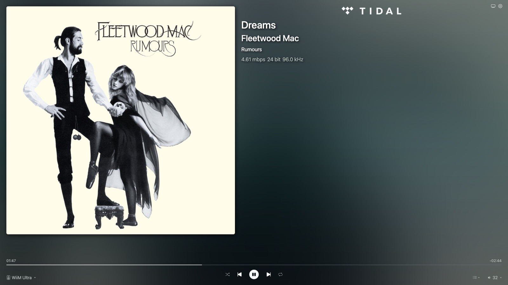
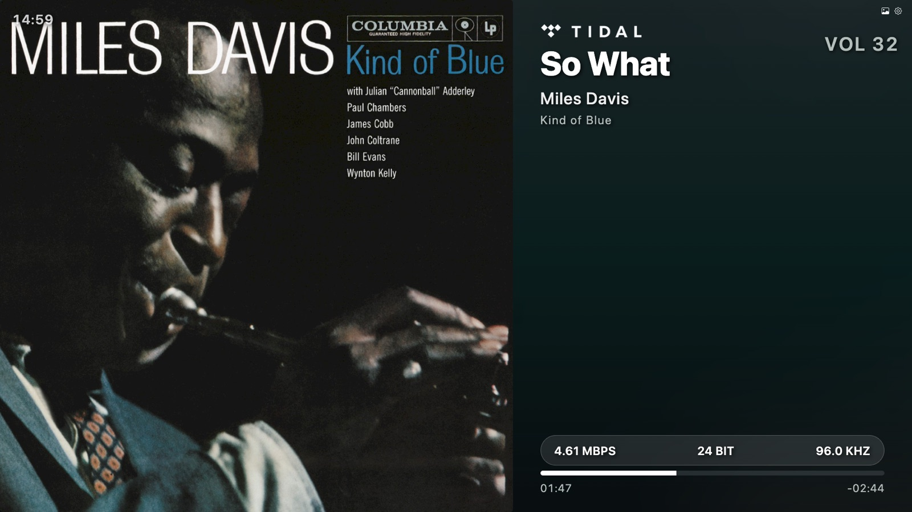
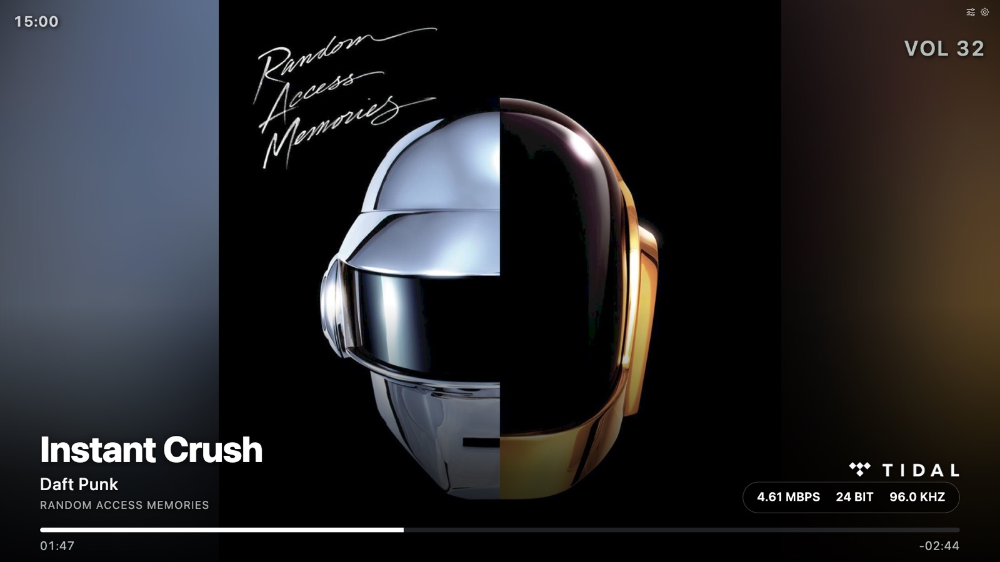
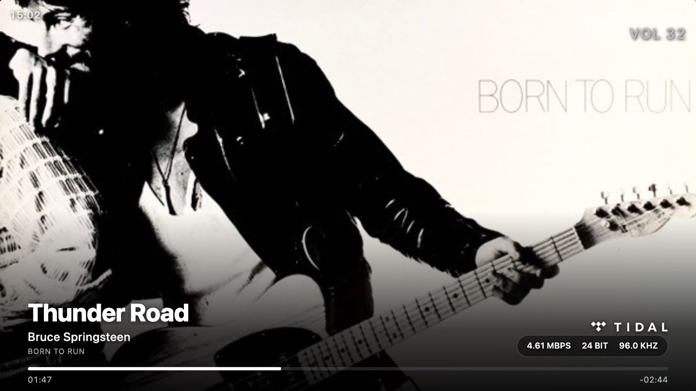
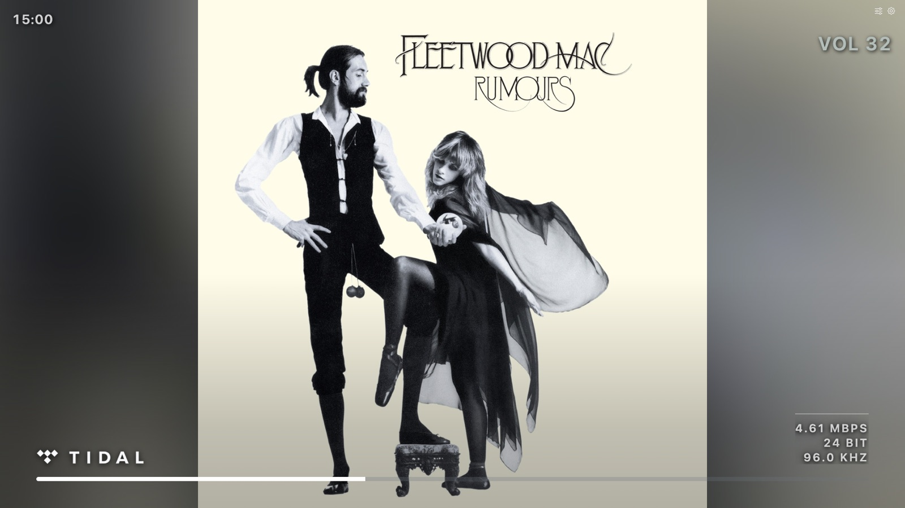
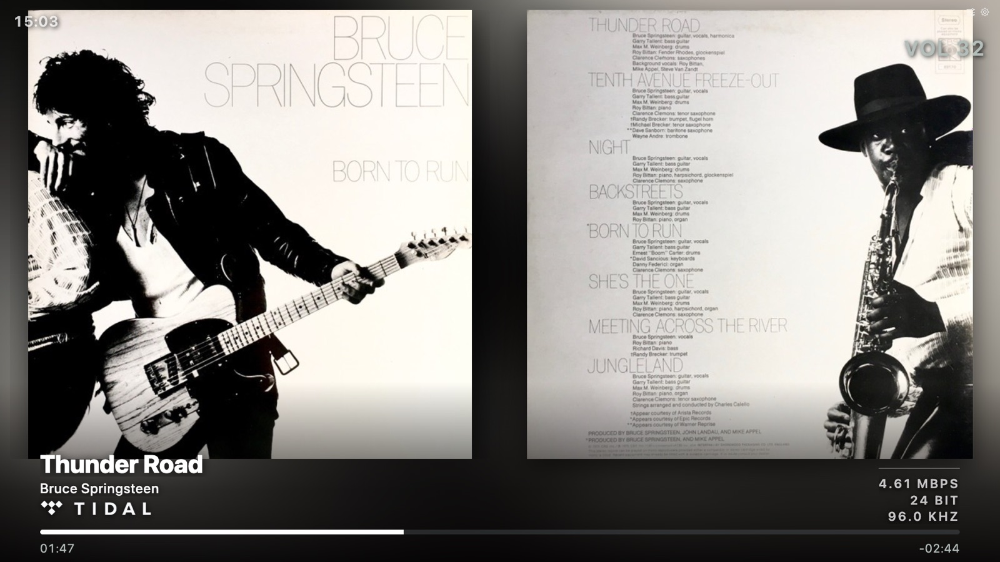

# WiiM Now Playing: custom layout

This is a personal fork of [cvdlinden/wiim-now-playing](https://github.com/cvdlinden/wiim-now-playing), tuned for a 1080p screen in a listening room that is driven by a Raspberry Pi 3B in kiosk mode, next to a WiiM Ultra.

All of the work lives on the [`custom-layout`](https://github.com/ashkap/wiim-now-playing/tree/custom-layout) branch. It tracks upstream releases (currently merged up to **v1.9.11**) and adds:

- **Two new display modes:** [Art mode](#art-mode) and [Sleeve mode](#sleeve-mode), on top of the restyled controller and TV mode
- **Source photos for Line In and Optical**, so inputs without metadata still look intentional
- **Kiosk reliability fixes:** album art that stops failing after a few hours, a playback-aware screen sleep, and a WiFi watchdog
- **A "Reload all screens" action**, to push client changes to the kiosk from a phone

> The screenshots below were captured at 1920×1080 in a desktop browser, with sample tracks fed to the display.

---

## Display modes

There are now four pages. The mode button in the top-right corner cycles through them: **Controller → TV → Art → Sleeve → Controller**. Each page shows the icon of the mode it switches to.

| Page | URL | What it's for |
| --- | --- | --- |
| Controller | `/` | Phone or tablet control, with the restyled layout |
| TV mode | `/tv.html` | The kiosk's everyday view: artwork plus large track info |
| Art mode | `/art.html` | Artwork first, with minimal chrome |
| Sleeve mode | `/sleeve.html` | Front cover beside the physical package (back cover, booklet) |

### Controller and TV mode (restyled)

Both pages use a custom SCSS skin. The type is larger and more legible from across the room, the quality readout is a single evenly spaced row, and the volume is shown in large type. The quality pill hides itself when a stream reports no quality info, so the kiosk never shows an empty box.

TV mode also gets an **idle state**: when playback is stopped, the stale track details are cleared and a large centred clock is shown instead.


*Controller (`/`)*


*TV mode (`/tv.html`)*

### Art mode

The artwork fills the screen, and only the essentials sit over a gradient at the bottom: title, artist, album, source, quality and progress. There are no lyrics in this mode.

The layout is set by **Settings → Art mode layout**. The setting is saved on the server and broadcast to every screen, so changing it on a phone changes the kiosk too.

| Layout | Behaviour |
| --- | --- |
| **Whole cover** | The full square cover at full height, with blurred artwork filling the sides |
| **Fill the screen** | The cover fills the 16:9 frame, cropping top and bottom |
| **Fill, slow pan (Ken Burns)** | Like Fill, but the cover drifts slowly (120 s) through its hidden top and bottom, so you see the whole cover over time |
| **Zoom out (each track)** | Each new album starts full-bleed and eases back over 90 s to the whole cover, with the blurred sides fading in |


*Art mode, whole cover*


*Art mode, fill the screen*

#### Pure art

**Settings → Let the artwork stand alone** (pure art) clears the screen down to the artwork and the elapsed bar. The source logo moves to the bottom left, and the audio quality becomes a small caption at the bottom right. On a track change the title and artist fade in, then fade out again after 20 seconds.


*Pure art, after the track details have faded out*

Notes on the Pi 3B:

- The blurred sides are drawn by blurring the artwork into a 128 px canvas and stretching it to full screen. The Pi's GPU drops a large CSS blur on a full-screen layer, leaving the base gradient showing at the edges. The canvas is cheap and renders reliably.
- Artwork only reloads when the image itself changes, not on every track. Playing straight through an album leaves the cover and its animation alone.
- All animation is GPU-composited transforms, and respects `prefers-reduced-motion`.

### Sleeve mode

The front cover sits on the left and a scan of the **physical package** on the right: the back cover where one exists, otherwise the tray card, booklet pages or liner notes. When a release has several scans, the right-hand panel cycles every 30 seconds.


*Sleeve mode: Born to Run, front and back*

The WiiM only ever provides a front cover, so the rest is looked up on the server through **MusicBrainz** and the **Cover Art Archive**. Most of the work went into finding the right scans:

- **Other pressings.** A title search usually finds a release with only a front cover scanned, while a reissue of the same record has the whole package. Checking the other pressings in the release group raised back-cover coverage from about a third to about three quarters, measured over 300 albums.
- **Looser matching on a miss.** If the exact search finds nothing, it tries again without edition suffixes like "(Remastered)" or "(Deluxe)" and without featured artists. Re-recordings like "(Taylor's Version)" are deliberately left intact.
- **Albums credited to someone else.** The device reports the *track's* artist. Playing "Careless Whisper" from Wham!'s *The Final* reports George Michael, so when no album matches the artist, the album is found through the track instead.
- **Printed artwork only.** An allow-list of scan types keeps disc and vinyl photos out, so the panel shows only the paper: back cover, tray card, booklet and liner notes.
- **Polite and cached.** Requests are queued at one every 1.2 s, results are cached to disk (`server/cache/sleeve`), and screens asking about the same album share one lookup.
- **Throttling isn't a miss.** MusicBrainz signals throttling with an HTTP 200 and an error body. These, and failed archive requests, are retried and never cached as "nothing scanned".

If an album genuinely has no scans, the front cover takes the whole stage instead of leaving an empty half. Both panels are sized to the same height, however different the scan resolutions are.

---

## Line In and Optical source photos

Analogue and optical inputs carry no title, artist or artwork. Upstream falls back to a random placeholder cover. This fork shows a full-screen photo of the source instead, with the clock, volume and quality pill (the WiiM's ADC sample rate) floating over it:

| Input | Photo |
| --- | --- |
| Line In | Technics SL-1200 turntable (`client/src/img/linein-turntable.jpg`) |
| Optical | Marantz CD-7 CD player (`client/src/img/optical-cdplayer.jpg`) |

Adding another input is one line in `WNP.s.sourcePhotos` (`client/src/js/wnp.js`), keyed by the device's `PlayMedium`. Image credits are in [`client/src/img/CREDITS.md`](client/src/img/CREDITS.md).

---

## Reliability fixes

### Album art that stops failing

The album art proxy (`/proxy-art`) had two problems that showed up as the generic placeholder appearing at random, then always, until a reboot:

- **Socket leak.** The proxy never aborted its upstream fetch when the browser moved on to the next track, and had no timeout. Orphaned connections to the art CDN built up until the process couldn't make outbound requests. The proxy now aborts on disconnect, times out after 8 s, and handles errors safely once streaming has started.
- **Broken IPv6.** Art CDNs advertise IPv6 addresses. On a network without working IPv6, Node sometimes picked one and failed. The proxy now forces IPv4: 30 of 30 fetches succeeded on the Pi, against 28 of 30 before.

The proxy also follows redirects (the Cover Art Archive needs this) and sends a `Cache-Control` header, so the `` and the blurred backdrop share one fetch. On the client, a failed cover is retried a few times before falling back to the placeholder.

### Playback-aware screen sleep: [`_extras/screen-sleep.sh`](_extras/screen-sleep.sh)

The script puts the monitor to sleep after 5 minutes with nothing playing, and wakes it as soon as playback resumes. It polls the WiiM's HTTP API rather than relying on a timer-based screensaver, which would blank the screen mid-album.

- Works on **Wayland** (`wlopm`, the Raspberry Pi OS Trixie default) and **X11** (`xset`). The `xset` approach is a silent no-op under Wayland.
- Reads the WiiM's IP from the server's `settings.json`, or from `WIIM_IP` if set.
- If the WiiM is unreachable, the idle countdown pauses, so a network blip never blanks the screen during playback.
- It checks the display's actual power state on every poll. If something else wakes the screen (a mouse nudge, a hotplug), it goes back to sleep a full idle period later instead of staying on.

Configure with `IDLE_SECS`, `POLL_SECS` and `WNP_DIR`, and launch it from the session autostart (see the header of the script).

### WiFi watchdog: [`_extras/wifi-watchdog.sh`](_extras/wifi-watchdog.sh)

The Pi 3B's onboard WiFi sometimes drops and doesn't reconnect, and turning off power-save wasn't enough. The watchdog pings the gateway every 30 s. After about 2 minutes of failures it restarts WiFi, and after about 6 minutes it reboots, so the kiosk recovers without a manual power-cycle.

It runs as a systemd service ([`wifi-watchdog.service`](_extras/wifi-watchdog.service)), independent of the graphical session. Thresholds and the gateway, interface and connection name are set through environment variables.

### Reload all screens

**Settings → Reload all screens** tells the server to reload every connected browser, so new client builds reach the kiosk from a phone or laptop without walking over to it. (Upstream's *Reload UI* only reloads the browser it's clicked in.)

---

## Running this fork

Setup is the same as upstream; see the [upstream documentation](https://cvdlinden.github.io/wiim-now-playing/). Then:

```bash
git clone -b custom-layout https://github.com/ashkap/wiim-now-playing.git
```

Point the kiosk browser at `/tv.html`, `/art.html` or `/sleeve.html` instead of `/`. Sleeve mode needs outbound internet access from the server for MusicBrainz and the Cover Art Archive.

Tests for the sleeve lookup and its cache are in `server/__tests__/` (`npm test`).

## Keeping up with upstream

Upstream lives at the `origin` remote. To take a new release:

```bash
git fetch origin --tags
git merge v1.x.y   # on custom-layout
```

Then rebuild the client (`npm run client-build`) so `server/public` picks up both sets of changes.
